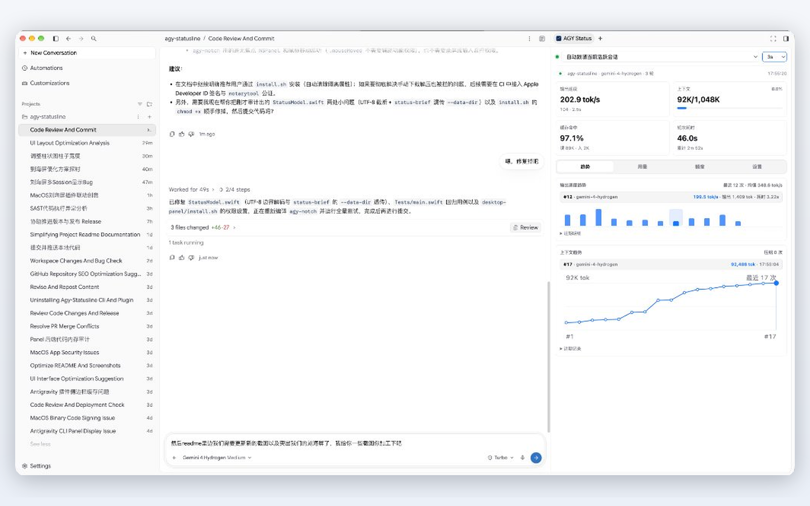
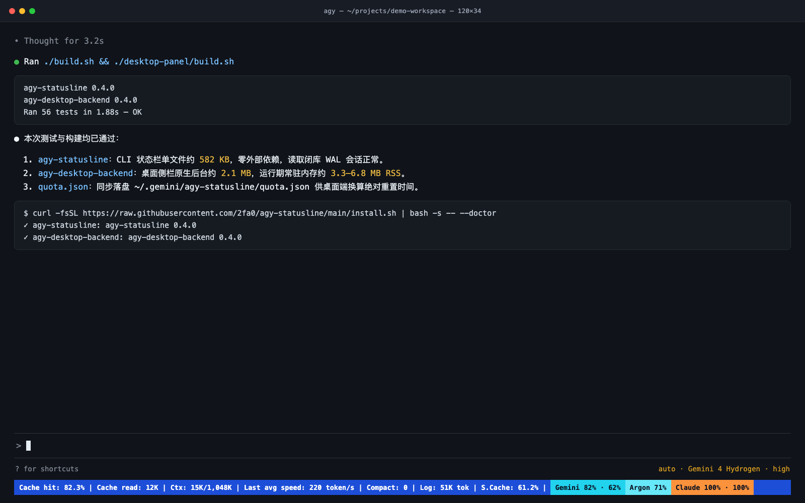

# agy-statusline — Google Antigravity Desktop & CLI Status Monitor

[中文](./README.md) | English

> A **local-only, read-only, zero-network** performance and quota telemetry suite for **Google Antigravity (Antigravity 2.0 Desktop & `agy` CLI)**.
> Monitor **real-time output speed (`tok/s`)**, **prompt cache hit rate**, **context window & compaction curves**, **per-model token usage**, and **absolute 5h / weekly quota reset times**.

<p align="left">
  
  
  
  
  
  
</p>

## Live Preview (Desktop & CLI Side-by-Side)

<table>
  <tr>
    <td width="50%" align="center">
      <strong>Antigravity 2.0 Desktop Side Panel</strong><br />
      <sub>Official <code>AUX_PANE</code> Sidecar · Real-time Speed · Interactive Charts</sub>
    </td>
    <td width="50%" align="center">
      <strong>Antigravity CLI (<code>agy</code>) Status Line</strong><br />
      <sub>Single Zig Binary · Zero Dependencies · Native Terminal Integration</sub>
    </td>
  </tr>
  <tr>
    <td width="50%">
      
    </td>
    <td width="50%">
      
    </td>
  </tr>
</table>

---

## Why `agy-statusline`? (Key Differences)

| Dimension | Default Antigravity / Typical Scripts | `agy-statusline` |
| :--- | :--- | :--- |
| **Desktop + CLI Coverage** | Single-surface only, or relies on external floating windows / browsers | **Unified Desktop + CLI**: native Desktop `AUX_PANE` sidecar panel + terminal `statusLine` (Zig) |
| **Real-Time Streaming Speed** | Only shows duration after a turn finishes, or no speed at all | **Live streaming speed (`≈ tok/s`)**: 1s polling while generating, then switches to exact average + 12-turn bar chart (yellow highlight when `<50 tok/s`) |
| **Quota Reset Times** | Relative countdowns only (e.g. "2d 4h left") | **Absolute local reset time**: formatted as exact local date/time (e.g. `Mon 11/23 11:29`), automatically separating Gemini / Argon / Claude 3p pools |
| **Context & Compaction Truth** | Current percentage only; hard to tell when compaction happened | **120-request interactive context curve + `CHECKPOINT` compaction markers** (`Compact: N`) — no guessed thresholds, no fabricated data |
| **Cache & Per-Model Breakdown** | Missing prompt cache hit rate or per-model stats | **Weighted cache hit rate (`Cache hit` / `S.Cache`) + per-model tokens / hit rate / avg speed** |
| **Ultra-Low Footprint** | Persistent Node.js / Python runtimes (tens to hundreds of MB RSS) | **Native Zig footprint**: ~`582 KB` CLI binary (exits immediately); ~`2.1 MB` Desktop daemon (with embedded `40 KB` UI), **~`3.3–6.8 MB RSS` measured**, with file fingerprint caching, incremental chunk parsing, and idle/hidden throttling |

---

## Data Access & Privacy

> [!IMPORTANT]
> **Zero External Network Requests · Local Session Read-Only**
>
> 1. **Official Extension Entrypoints Only**: Built strictly on Google Antigravity's official extension mechanisms — `statusLine` protocol for CLI, and official `Plugin` / `UI Sidecar` (`SIDECAR_UI_ENTRYPOINT_AUX_PANE`) + `Lifecycle Hooks` for Desktop.
> 2. **Zero Network Traffic**: Makes no HTTP / HTTPS / WebSocket outbound requests; collects or uploads zero telemetry or conversation data.
> 3. **Zero Credential / Token Access**: Never reads OAuth tokens, cookies, session keys, or API credentials. Desktop quota display reads only the local snapshot `quota.json` written by the CLI status line (containing only remaining percentage and reset timestamps, no account or credential info).
> 4. **No Internal RPC Probing or Client Patching**: Never calls undocumented internal RPCs, never modifies Antigravity client files, and never bypasses any quota or permission checks.
> 5. **Strict Local Read-Only**: SQLite connections enforce `mode=ro` and `PRAGMA query_only = ON` (safely falling back to `immutable=1` read-only mode only for archived WAL databases with no active `-wal`).
>
> *Note: Local logs and SQLite/protobuf schemas are internal host formats rather than stable public APIs; host upgrades may affect individual fields.*

---

## 30-Second Quick Install

One command installs both the **Desktop Side Panel** and **CLI Status Line**. It downloads the native binary for your platform, verifies `SHA256SUMS.txt`, clears macOS `quarantine` attributes (and reads back to confirm), and runs a self-check immediately:

```sh
curl -fsSL https://raw.githubusercontent.com/2fa0/agy-statusline/main/install.sh | bash
```

- Install one side only: `... | bash -s -- --panel-only` or `--cli-only`
- Pin a version: `AGY_STATUSLINE_TAG=v0.4.0 ... | bash`
- **Upgrade / Reinstall**: run the exact same command again (idempotent overwrite)
- Uninstall: `... | bash -s -- --uninstall`

Two quick steps after installing:

1. **Desktop Panel**: Restart Antigravity Desktop, then click **`+` → `AGY Status`** in the top-right auxiliary pane of any conversation.
2. **CLI**: Add the `statusLine` snippet below to `~/.gemini/antigravity-cli/settings.json` (the installer prints the exact path):

```json
{
  "statusLine": {
    "type": "command",
    "command": "~/.gemini/antigravity-cli/agy-statusline",
    "stack_with_default": true
  }
}
```

### Troubleshooting (`--doctor`)

```sh
curl -fsSL https://raw.githubusercontent.com/2fa0/agy-statusline/main/install.sh | bash -s -- --doctor
```

Prints platform info, install paths, `quarantine` status, code-signing integrity, binary self-check results, and macOS security environment (Gatekeeper, MDM management, Developer ID policy requirements).

Add `--json` for a machine-readable report. Every failure carries a stable code, so a script or an agent can branch on it instead of matching prose:

```sh
./install.sh --doctor --json
```

```json
{
  "ok": false,
  "platform": "Darwin arm64",
  "codes": ["panel_missing", "version_mismatch"],
  "remediation": { "panel_missing": "未找到面板插件；运行 ./install.sh --panel-only 安装，然后重启 Antigravity Desktop。" },
  "checks": [{ "key": "panel.dir", "value": "...", "code": "panel_missing" }]
}
```

Exit code is `0` only when `ok` is `true`. Codes: `cli_missing`, `cli_quarantine`, `cli_signature_invalid`, `cli_not_runnable`, `panel_missing`, `backend_missing`, `backend_quarantine`, `backend_signature_invalid`, `backend_not_runnable`, `version_mismatch`, `mdm_requires_developer_id`, `statusline_not_configured`.

### macOS Security Note

This project uses **ad-hoc code signing** (`codesign --sign -`) without an Apple Developer ID or notarization:

| Install Method | Result |
| :--- | :--- |
| `curl ... \| bash` (Recommended) | ✅ Works out of the box (`curl` does not attach `quarantine`, so Gatekeeper does not block it) |
| Browser download (`.tar.gz` / `.zip`) | ❌ Blocked by Gatekeeper unless `quarantine` is cleared |

If you downloaded via browser, run:

```sh
xattr -dr com.apple.quarantine ~/.gemini/config/plugins/agy-desktop-status
xattr -dr com.apple.quarantine ~/.gemini/antigravity-cli
```

> Windows users can use the PowerShell installer (`install.ps1`), detailed in the sections below.

---

## 1. Antigravity 2.0 Desktop Side Panel (`AGY Desktop Status`)

Provides a persistent monitoring card and interactive charts in the right auxiliary pane of Antigravity 2.0 Desktop (side-by-side with the conversation canvas, without blocking chat), featuring **auto-follow active conversation**, **adaptive refresh (`3s` / `5s` / `10s` active, `15s` idle, paused when hidden, or manual `Pause`)**, **light/dark theme adaptation**, and history switching.

> [!NOTE]
> Uses the official `SIDECAR_UI_ENTRYPOINT_AUX_PANE` entrypoint. Antigravity 2.x sidecar UI supports `AUX_PANE` / `FULL_PANE` / `SIDEBAR` only (no top-bar attachment).

### Real-Time Streaming Speed

While a model is actively generating, the Speed card switches to live mode (polling local DB every **1s**, zero network), estimating `≈ tok/s` from character growth rate and the session's historical char-to-token ratio, then switching back to exact average speed and historical trend bars once the step completes.

### Session State: Four States, Each With a Reason

The header carries a state chip. Hovering it shows the full sentence, and the state is computed in the native backend from hook events, the active step row and stream growth — the UI only renders it, so thresholds exist in exactly one place.

| State | Chip | Trigger | Example explanation |
| :--- | :--- | :--- | :--- |
| Ready | green dot | previous turn stopped, or idle | "Session idle, waiting for input." |
| Running | blue pulse | active step, fresh `PreInvocation`, or local tool work after `PostInvocation` | "The tool for this step is still running locally (12s)." |
| Waiting | amber pulse | first byte > `20s`, model switch prefill, or stream silent for `25s` | "Waiting 34s for the first token: long prefill or server queueing; the connection is still alive." |
| Failed | red pulse | turn ended with a non-cancel `terminationReason` | "Turn ended with an error (MODEL_ERROR: upstream 503)." |

Four deliberate details: a user cancel is **not** an error (`CANCELLED` returns to a green dot); switching models explains the wait instead of looking stuck; a stream that stops growing for `25s` is reported as stalled while a merely slow one still reads as running; when the conversation database is locked or missing the chip falls back to "can't confirm" instead of guessing; a sidecar that stops answering replaces the strip with "backend not responding · 12s"; and every snapshot carries a `sources` block (`db` / `transcript` / `hooks` / `quota` states plus reason codes) so an unreadable source raises "incomplete data · database busy" instead of quietly rendering zeros. Thresholds live in `config.json`; the rules are covered by 16 unit tests.

### Personalisation: `config.json` (no restart)

The root `./install.sh` writes `~/.gemini/agy-statusline/config.json` on first install (an existing file is never overwritten, and it survives uninstall). Saves apply within one poll cycle — no Antigravity restart:

| Key | Effect |
| :--- | :--- |
| `enabled` | `false` shows a single "disabled" line and reads neither the database nor the quota file |
| `layout` | `compact` chip only; `detailed` adds the full reason line and the wait duration on the chip |
| `pollSec` | default interval (`0` keeps the adaptive policy; a manual dropdown choice wins) |
| `lowSpeedWarnTokS` | low-speed warning threshold, default `50` |
| `thresholds` | `waitSec` / `stallSec` / `toolGraceSec` for the state machine |
| `modules` | switch off `session` / `quota` / `history` / `context` / `models` individually |
| `debug` | adds `session.evidence` to the JSON for troubleshooting |

Out-of-range values are clamped (`pollSec: 999` → `60`), so a bad edit degrades instead of breaking. Override the path with `AGY_STATUSLINE_SETTINGS`; defaults are in [`config.example.json`](./config.example.json).

### Absolute Quota Reset Times

The **Quota** tab converts 5h and weekly quota windows into absolute local timestamps (e.g., `Today 11:29`, `Mon 11/23 11:29`) by reading the local `~/.gemini/agy-statusline/quota.json` snapshot written by the CLI status line (override path via `AGY_STATUSLINE_QUOTA_FILE`).

### Session Usage, Context Curve & Per-Model Stats

- **Context Curve & Compaction Events**: Plots up to the last 120 completed requests with dashed markers for `status=DONE` `CHECKPOINT` compactions (`Compact: N`).
- **Turn / Session Totals**: Displays token usage (`input_tokens + cache_read_tokens + output_tokens`) and weighted prompt cache hit rate.
- **Per-Model Breakdown**: Groups by model (merging thinking-level suffixes) and shows tokens, cache hit rate, and average output speed.

### Manual Desktop Plugin Install / Uninstall

1. Download from [Releases](https://github.com/2fa0/agy-statusline/releases):
   - macOS / Linux: `agy-desktop-status-plugin.tar.gz`
   - Windows: `agy-desktop-status-plugin.zip`
2. Extract and run:
   - **macOS / Linux**: `./install.sh` (uninstall: `~/.gemini/config/plugins/agy-desktop-status/install.sh --uninstall`)
   - **Windows (PowerShell)**: `powershell -ExecutionPolicy Bypass -File .\install.ps1` (uninstall: `... -Uninstall`)

What uninstall actually touches (root `./install.sh --uninstall`; the plugin-local script removes only the plugin directory):

| Action | Target |
| :--- | :--- |
| **Removed** | `~/.gemini/config/plugins/agy-desktop-status/` |
| **Removed** | `~/.gemini/antigravity-cli/agy-statusline` |
| **Kept** | `~/.gemini/agy-statusline/config.json` (your settings, reused on reinstall) |
| **Kept** | `~/.gemini/agy-statusline/quota.json` (the CLI keeps refreshing it) |
| **Manual** | the `statusLine` entry in `settings.json` (or run `/statusline delete` inside AGY) |

An open Antigravity window needs one restart before the panel disappears completely.

For building from source or frontend customization, see [desktop-panel/README.md](./desktop-panel/README.md).

---

## 2. Antigravity CLI Status Line (`agy-statusline`)

Lightweight, zero-dependency custom `statusLine` binary for **Google Antigravity CLI (`agy`)** written in Zig (supporting **macOS / Linux / Windows**), with automatic responsive wrapping in narrow terminals:

- **Cache Hit Rate & Reads** (`Cache hit` / `Cache read`)
- **Context Usage** (`Ctx: used/window`)
- **Last Turn Average Output Speed** (`Last avg speed`, switches to yellow highlight below `50 tok/s`)
- **Compaction & Session Log Totals** (`Compact: N`, `Log`, `S.Cache`)
- **Per-Pool Remaining Quotas**: Automatically adapts to Free / Plus / Pro / Ultra tiers for **Gemini**, **Argon**, and **Claude / 3p** pools, and writes `~/.gemini/agy-statusline/quota.json` for the Desktop panel.

### Building CLI from Source

Requires Zig `0.14.1`:

```sh
./build.sh
./install.sh
```

See [`.github/workflows/release.yml`](.github/workflows/release.yml) for static cross-compilation builds (Linux x64/arm64, Windows x64).
