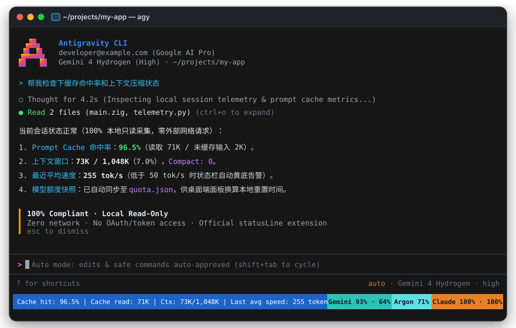

# agy-statusline — Google Antigravity CLI & Desktop 状态监控套件

一套轻量、零外部依赖、**100% 本地只读（Zero Network）** 的 **Google Antigravity** 状态栏与性能遥测工具，同时支持 **Antigravity CLI (`agy`)** 与 **Antigravity 2.0 桌面端（Desktop 右侧辅助栏常驻面板）**：

| 形态 | 适用场景 | 核心展示指标 | 目录 / 产物 |
| :--- | :--- | :--- | :--- |
| **CLI 状态栏 (`agy-statusline`)** | Antigravity CLI (`agy`) 终端底部 `statusLine` | 模型剩余额度（Gemini / Argon / Claude）、上下文窗口占用（`Ctx`）、Prompt 缓存命中率（`Cache hit`）、平均输出速度（`tok/s`） | 根目录 [main.zig](./main.zig) |
| **Desktop 右侧面板 (`AGY Desktop Status`)** | Antigravity 2.0 桌面端右侧辅助栏常驻 Tab | 生成中的实时输出速度（字/s → ≈tok/s）、上下文占用（`Ctx`）、周额度 / 5h 额度重置时间（绝对本地时间）、平均输出速度 & 速度趋势图、轮次/会话耗时、Prompt 缓存命中率 | [desktop-panel/](./desktop-panel/) |

> [!NOTE]
> **合规与隐私说明**：本仓库中的所有工具均严格基于 Google Antigravity 官方开放的扩展机制（CLI `statusLine` 扩展、Desktop `Plugin` / `UI Sidecar` / `Lifecycle Hooks`）构建。**全程零外部网络请求、不读取任何 OAuth Token 或 API 凭据、不调用或探测任何未公开的内部 RPC 接口、不修改客户端文件、不绕过任何 Google / Antigravity 配额或权限限制**。所有统计数据仅以只读方式（SQLite `mode=ro` & `PRAGMA query_only = ON`）解析本地已落盘的会话记录。

---

## 一、Antigravity 2.0 桌面端右侧面板（`AGY Desktop Status`）

在 Antigravity 2.0 桌面端右侧辅助栏提供常驻监控卡片与可交互速度趋势图（与对话画布同屏并排展示，不遮挡会话），支持**自动跟随当前活跃会话**、**自适应刷新（活跃时按所选的 `3s` / `5s` / `10s` 间隔刷新，空闲 15s，面板隐藏时暂停；也可选择 `关闭`）**、**深浅色主题自适应**以及手动切换历史会话。

> [!NOTE]
> 入口为官方 `SIDECAR_UI_ENTRYPOINT_AUX_PANE`。Antigravity 2.x 的 sidecar UI 只有 `AUX_PANE` / `FULL_PANE` / `SIDEBAR` 三种入口，**不支持顶栏挂载**，因此无法把状态条贴到窗口上边栏。

### 生成中实时速度（`实时输出速度`）

模型正在回话时，面板会把“平均输出速度”卡片切成实时模式：标题变成 `实时输出速度` 并打上呼吸点，数值是**正在生成的这一步**的速度，浅色页头也会多一个 `生成中 · Ns` 的胶囊：

```
实时输出速度                                    tok/s
≈ 110.7 tok/s
已输出 339 字 · 128 字/s · 2.6s
```

原理：AGY 在生成过程中会先写入这条未完成的 step 行（`status = GENERATING`），并随着流式文本增长不断重写 `steps.step_payload`。面板只读这一行算出字符增长速率，再用同一会话已完成步骤的「字数 / 输出 token」比例换算成 `≈ tok/s`（实测中文约 `1.15~1.3 字/token`）。**真 token 数只在整步完成后落库**，所以生成中的 tok/s 是估算值（带 `≈`），完成后自动回到精确的平均速度与历史趋势。

生成期间面板会提高到 **1s 一轮**轮询（仍是本地只读，不联网）；上下文占用（`Ctx`）是 prompt 侧实测值，只在每一步完成后刷新，卡片 tooltip 会写明。

### 额度重置时间（不再自己换算 “还剩 2 天 4 小时”）

面板里的 **额度重置时间** 区块把周额度 / 5h 额度的重置写成具体本地时间，例如：

```
Gemini  周额度    88%   重置于 11/23 周一 11:29 · 剩 3 天 1 小时
Gemini  5h 额度   96%   重置于 今天 11:29 · 剩 1 小时 58 分
```

数据来源说明（**不联网、不读凭据**）：桌面端本身不向插件暴露额度信息，因此 CLI 状态栏在每次渲染时会把 AGY 递交给它的 `quota` 字段（`remaining_fraction` + `reset_in_seconds`）写成本地快照：

- 默认路径：`~/.gemini/agy-statusline/quota.json`（可用 `AGY_STATUSLINE_QUOTA_FILE` 环境变量改写）；
- 只包含百分比与重置时间戳，**不含 token、账号或任何凭据**；
- 长时间没跑过 `agy` CLI 时，面板会按 5h / 7 天的周期把重置时间推算到下一次，并标注「快照 X 天前 · 时间按周期推算」，百分比也会标记为旧数据。


### 傻瓜式安装（三种方式任选其一）

#### 方式 1：一行命令自动安装（macOS / Linux，最推荐）

无需克隆代码、无需安装 Node.js 或编译前端（已内置预构建单文件 UI，仅需系统自带的 `python3`）：

```sh
curl -fsSL https://raw.githubusercontent.com/2fa0/agy-statusline/main/desktop-panel/install.sh | bash
```

#### 方式 2：从 Releases 下载插件包安装（macOS / Linux / Windows）

1. 前往 [Releases](https://github.com/2fa0/agy-statusline/releases) 页面下载桌面端插件包：
   - macOS / Linux：`agy-desktop-status-plugin.tar.gz`
   - Windows：`agy-desktop-status-plugin.zip`
2. 解压后运行对应平台的安装脚本：
   - **macOS / Linux**：
     ```sh
     tar -xzf agy-desktop-status-plugin.tar.gz
     cd agy-desktop-status
     ./install.sh
     ```
   - **Windows (PowerShell)**：
     ```powershell
     Expand-Archive -Path agy-desktop-status-plugin.zip -DestinationPath .
     cd agy-desktop-status
     powershell -ExecutionPolicy Bypass -File .\install.ps1
     ```

#### 方式 3：克隆源码安装（适合开发者自定义修改）

```sh
git clone https://github.com/2fa0/agy-statusline.git
cd agy-statusline/desktop-panel
./install.sh --link   # 使用软链接安装，本地修改即时生效（默认也是软链接；加 --copy 则为独立拷贝）
```

### 如何打开面板

1. 安装完成后，**打开或重启 Antigravity Desktop**；
2. 在任意对话窗口右上角辅助栏点击 **`+` 菜单** → 选择 **`AGY Status`**；
3. 面板默认自动跟随当前活跃会话，活跃时按所选的 3/5/10 秒间隔刷新，空闲时自动降频到 15 秒。

### 如何卸载桌面端插件

- **macOS / Linux**：
  ```sh
  ~/.gemini/config/plugins/agy-desktop-status/install.sh --uninstall
  ```
- **Windows (PowerShell)**：
  ```powershell
  powershell -ExecutionPolicy Bypass -File "$HOME\.gemini\config\plugins\agy-desktop-status\install.ps1" -Uninstall
  ```

更多关于桌面端插件的架构与前端二次开发说明，请参阅 [desktop-panel/README.md](./desktop-panel/README.md)。

---

## 二、Antigravity CLI 终端状态栏（`agy-statusline`）

轻量、零依赖的 **Google Antigravity CLI (`agy`)** 自定义 `statusLine` 工具（基于 Zig 编写，支持 **macOS / Linux / Windows**），在终端宽度不足时自动折行对齐。



### 展示功能与特性

- **缓存命中率与读取量**（`Cache hit` / `Cache read`）：命中率按 `缓存读取 /（未缓存输入 + 缓存读取）` 计算；缺失数据、输入为零或缓存写入非零时显示 `--`。该口径取决于模型和 AGY 提供的字段语义。
- **上下文占用**（`Ctx: 已用/总上下文`）：优先使用当前轮 `current_usage` 中的输入与缓存 token 之和（缺失时回退到 `total_input_tokens`），对比 `context_window_size` 展示。
- **平均输出速度**（`Last avg speed`）：最近一次已完成模型请求的平均输出速度，包含思考 token；通过只读查询当前会话数据库（`~/.gemini/antigravity-cli/conversations/<conversation_id>.db`）中的生成元数据计算，非实时速度；数据缺失、耗时过短或数值异常时显示 `--`。速度低于 `50 token/s` 时主状态栏切换为黄底黑字提示。
- **模型剩余额度**（按 AGY 实际返回的 `quota` 字段动态展示，自动兼容 Free / Plus / Pro / Ultra 各档位）：
  - **Gemini**（青色背景）：展示 `5h · weekly` 双窗口（若仅有周额度则显示单值）。
  - **Argon**（亮青色背景）：Pro 套餐下独立计算周额度时单独展示；Ultra / Plus / Free 套餐无独立 Argon 池时自动隐藏。
  - **Claude / 第三方模型**（橙色背景，匹配 `3p` / `claude` / `gpt` / `anthropic`）：展示 `5h · weekly` 双窗口；无第三方池时自动隐藏。
  - 同时把本次 `quota` 快照（百分比 + 重置时间）写入 `~/.gemini/agy-statusline/quota.json`，供桌面端面板换算成绝对本地重置时间；路径可用 `AGY_STATUSLINE_QUOTA_FILE` 覆盖。

### 使用方法

#### 1. 下载可执行文件

**方式 A：命令行 `curl` 一键下载（macOS / Linux 推荐）**

使用 `curl` 下载并解压到 `~/.gemini/antigravity-cli/`，在 macOS 上**不会产生浏览器隔离属性（`com.apple.quarantine`）**，可直接避开 Gatekeeper 弹窗拦截：

- **macOS (Apple Silicon / arm64)**：
  ```sh
  mkdir -p ~/.gemini/antigravity-cli
  curl -fsSL https://github.com/2fa0/agy-statusline/releases/latest/download/agy-statusline-macos-arm64.tar.gz \
    | tar -xz -C ~/.gemini/antigravity-cli
  chmod +x ~/.gemini/antigravity-cli/agy-statusline
  ```
- **Linux (x64)**：
  ```sh
  mkdir -p ~/.gemini/antigravity-cli
  curl -fsSL https://github.com/2fa0/agy-statusline/releases/latest/download/agy-statusline-linux-x64.tar.gz \
    | tar -xz -C ~/.gemini/antigravity-cli
  chmod +x ~/.gemini/antigravity-cli/agy-statusline
  ```

**方式 B：从 Releases 页面手动下载（macOS / Linux / Windows）**

前往本仓库的 [Releases](https://github.com/2fa0/agy-statusline/releases) 页面，下载对应平台的压缩包并解压：

- **Linux (x64)**: `agy-statusline-linux-x64.tar.gz`
- **macOS (Apple Silicon / arm64)**: `agy-statusline-macos-arm64.tar.gz`
- **Windows (x64)**: `agy-statusline-windows-x64.zip`

Linux / macOS 解压后请确保文件有可执行权限，例如：

```sh
tar -xzf agy-statusline-macos-arm64.tar.gz
chmod +x agy-statusline
```

> **macOS 提示**：Release 包中的 macOS 二进制已内置规范的 ad-hoc 代码签名（不会触发 Apple Silicon 的 `SIGKILL`）。但若通过**浏览器**手动下载，macOS 会附加 `com.apple.quarantine` 隔离属性导致首次运行被 Gatekeeper 拦截，执行以下命令清除即可：
> ```sh
> xattr -dr com.apple.quarantine /path/to/agy-statusline
> ```

#### 2. 配置 AGY CLI

编辑 `~/.gemini/antigravity-cli/settings.json`（Windows 为 `%USERPROFILE%\.gemini\antigravity-cli\settings.json`），添加 `statusLine` 配置：

```json
{
  "statusLine": {
    "type": "command",
    "command": "/path/to/agy-statusline",
    "stack_with_default": true
  }
}
```

Windows 示例（注意路径分隔符转义或使用正斜杠）：

```json
{
  "statusLine": {
    "type": "command",
    "command": "C:/path/to/agy-statusline.exe",
    "stack_with_default": true
  }
}
```

- `stack_with_default`: 设为 `true` 时保留 AGY 默认状态栏并在其下方叠加显示本工具输出；设为 `false` 则仅显示本工具输出。

#### 3. 恢复默认状态栏

在 AGY 中运行 `/statusline delete`，或从 `settings.json` 中删除 `statusLine` 字段即可恢复默认状态栏。

### 从源码构建 CLI

需要 Zig 0.14.1。

- **macOS**（使用系统 clang 和 SQLite）：
  在本目录运行 `./build.sh`；如果 Zig 不在 `PATH` 中，运行 `ZIG=/path/to/zig ./build.sh`。
- **Release 静态构建**（Linux x64 / Windows x64）：
  参考 [`.github/workflows/release.yml`](.github/workflows/release.yml) 中使用 SQLite amalgamation 静态链接的方式。
