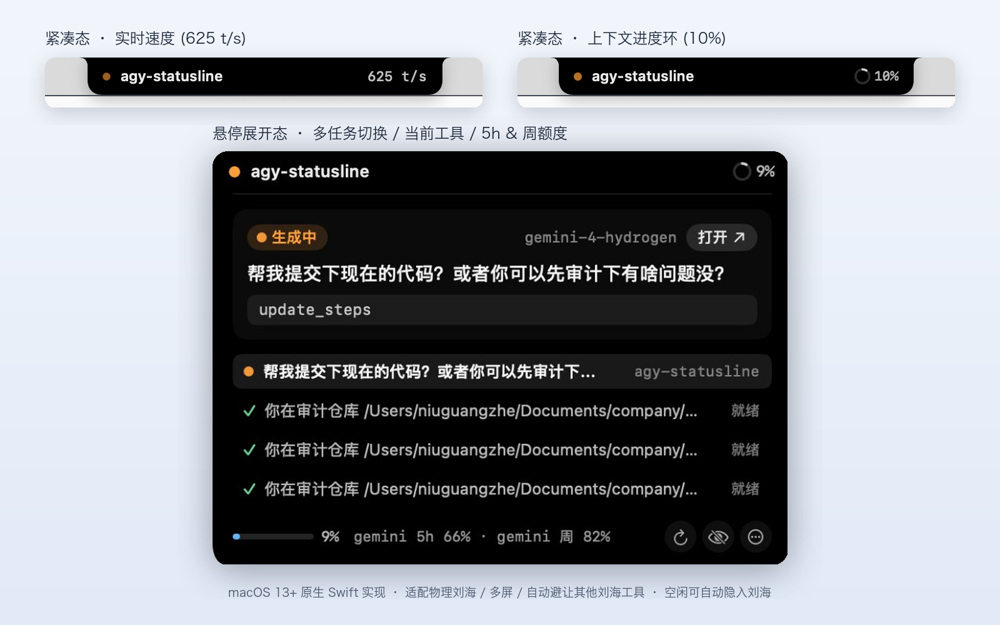
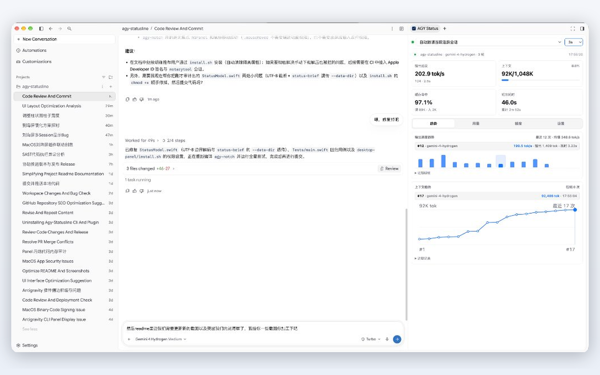

# agy-vitals — Status & Quota Monitor for Google Antigravity

English | [简体中文](./README.zh-CN.md)

> **Make every generation in Google Antigravity (macOS Notch · Desktop 2.0 · `agy` CLI) transparent.**
> Track **real-time output speed (`tok/s`)**, **prompt cache hit rate**, **context & compaction curves**, **per-model usage**, and **exact local 5h / weekly quota reset times** — 100% local, read-only, zero network.

<p align="left">
  
  
  
  
  
  
  
</p>

## Live Preview (macOS Notch · Desktop · CLI)

<p align="center">
  <strong>macOS Dynamic Island Notch</strong><br />
  <sub>Compact Live Speed / Context Ring · Hover for Multi-Session, Active Tool & Quota · Auto-Avoidance</sub><br /><br />
  
</p>

<table>
  <tr>
    <td width="50%" align="center">
      <strong>Antigravity 2.0 Desktop Side Panel</strong><br />
      <sub>Side-by-Side <code>AUX_PANE</code> · Live Speed · Interactive Charts · Settings Tab</sub>
    </td>
    <td width="50%" align="center">
      <strong>Antigravity CLI (<code>agy</code>) Status Line</strong><br />
      <sub>Single Zig Binary · Zero Dependencies · Native Terminal Integration</sub>
    </td>
  </tr>
  <tr>
    <td width="50%">
      
    </td>
    <td width="50%">
      
    </td>
  </tr>
</table>

---

## Why `agy-vitals`?

| What You Care About | Default / Typical Scripts | `agy-vitals` |
| :--- | :--- | :--- |
| **macOS Notch Monitor** | Lose sight of generation progress when switching apps or fullscreen | **Native Swift Dynamic Island**: compact live speed / context ring, hover to switch tasks & inspect tools/quota, auto-hides into the physical notch when idle |
| **All-in-One Surfaces** | Single-surface only, or relies on external windows | **Notch + Desktop + CLI**: macOS notch bar + native Desktop `AUX_PANE` sidecar + terminal `statusLine` |
| **Live Speed** | Only shows total duration after a turn ends | **Real-time `≈ tok/s` while streaming**: 1s live updates, yellow alert below `50 tok/s`, plus a 12-turn bar chart |
| **Why Is It Waiting?** | Hard to tell queueing from tool runs or errors | **4-State Chip + Plain-English Reason**: shows whether it's waiting for first token, running local tools, warming cache, or failed |
| **Quota Reset Time** | Relative countdowns like "2d 4h left" | **Absolute Local Timestamps**: e.g. `Today 11:29` / `Mon 11/23 11:29`, separating Gemini / Claude 3p pools |
| **Context & Cache** | Current percentage only | **120-Request Curve + Compaction Markers**: spots `CHECKPOINT` events and breaks down tokens, cache hit rate & speed per model |
| **Footprint** | Persistent Node.js / Python runtimes (tens/hundreds of MB) | **Native Zig**: ~`582 KB` CLI (exits immediately), Desktop daemon uses only **`3.3–6.8 MB RSS`** |

---

## Privacy & Security

> [!IMPORTANT]
> **100% Local Read-Only · Zero Network Requests · Zero Credential Access**
>
> - **Official Extension Entrypoints Only**: Built strictly on Antigravity's official `statusLine` protocol (CLI) and `Plugin / UI Sidecar (AUX_PANE) + Lifecycle Hooks` (Desktop); never modifies client binaries or files.
> - **Zero Outbound Network**: Makes no HTTP / HTTPS / WebSocket requests and collects or uploads zero telemetry or conversation data.
> - **No Credentials or Tokens**: Never reads OAuth tokens, cookies, session keys, or API keys; never probes undocumented internal RPCs or bypasses quota checks.
> - **Strict Read-Only Access**: Reads local session records with `mode=ro` / `PRAGMA query_only = ON` and the numeric-only `quota.json` snapshot (percentages and reset timestamps only) written by the CLI status line.

---

## 30-Second Quick Install

One command installs both the **Desktop Side Panel** and **CLI Status Line** (verifies `SHA256SUMS.txt`, clears macOS `quarantine`, and runs a self-check):

```sh
curl -fsSL https://raw.githubusercontent.com/2fa0/agy-vitals/main/install.sh | bash
```

- Install one side only: `... | bash -s -- --panel-only` or `--cli-only`
- Upgrade / Reinstall: run the same command again
- Uninstall: `... | bash -s -- --uninstall` (preserves your `config.json` and `quota.json`)

### Enable After Installing (2 Steps)

1. **Desktop Panel & macOS Notch**: Restart Antigravity Desktop, then click **`+` → `AGY Status`** in the top-right auxiliary pane of any conversation; on macOS 13+, the Dynamic Island notch bar launches automatically and can be configured in the panel's **Settings** tab or the notch right-click menu.
2. **CLI Status Line**: Add this snippet to `~/.gemini/antigravity-cli/settings.json`:

```json
{
  "statusLine": {
    "type": "command",
    "command": "~/.gemini/antigravity-cli/agy-statusline",
    "stack_with_default": true
  }
}
```

On macOS 13+, the CLI package also includes the notch app. The next status line refresh launches it without requiring Desktop. The CLI notch stays resident independently; use its menu to hide or disable it. Clicking a task activates that session's recorded terminal application, without selecting a specific tab. For custom CLI directories, install with `AGY_CLI_DIR` and use the status line command printed by the installer.

### Troubleshooting (`--doctor`)

```sh
curl -fsSL https://raw.githubusercontent.com/2fa0/agy-vitals/main/install.sh | bash -s -- --doctor
```

Checks install paths, binary self-tests, macOS `quarantine`, code-signing integrity, and Gatekeeper / MDM policies (supports `--doctor --json` for machine-readable error codes).

---

<details>
<summary>Advanced: <code>config.json</code>, Windows / Manual Install, macOS Signing & Building from Source</summary>

### 1. Personalization (`~/.gemini/agy-statusline/config.json`)

Created on first install and hot-reloaded within one poll cycle without restarting Antigravity (full defaults in [`config.example.json`](./config.example.json)):

```json
{
  "enabled": true,
  "layout": "compact",
  "pollSec": 0,
  "lowSpeedWarnTokS": 50,
  "thresholds": { "waitSec": 20, "stallSec": 25, "toolGraceSec": 120 },
  "modules": { "session": true, "quota": true, "history": true, "context": true, "models": true },
  "debug": false
}
```

- `layout`: `compact` shows the status chip only; `detailed` adds the full reason line below it.
- `pollSec`: `0` uses adaptive polling (`1s` while streaming, `3–10s` active, `15s` idle, paused when hidden).
- `modules`: toggle individual cards off (disabling `quota` skips reading `quota.json`).

### 2. Windows & Manual Release Install

Download archives from [Releases](https://github.com/2fa0/agy-vitals/releases):
- **Desktop Panel**: `agy-desktop-status-plugin.tar.gz` (macOS/Linux) or `agy-desktop-status-plugin.zip` (Windows: `powershell -ExecutionPolicy Bypass -File .\install.ps1`).
- **CLI Status Line**: Extract the binary for your platform and point `statusLine.command` in `settings.json` to it (you can also pin a version via `AGY_STATUSLINE_TAG=v0.4.0`).

### 3. macOS Signing & Gatekeeper

Binaries use **ad-hoc code signing** (no Apple Developer ID / notarization):
- Installing via `curl ... | bash` does not attach `quarantine` and works out of the box.
- Browser downloads attach `com.apple.quarantine` and are blocked by Gatekeeper unless cleared by `./install.sh` or `xattr -dr com.apple.quarantine ~/.gemini/config/plugins/agy-desktop-status ~/.gemini/antigravity-cli`.
- If an enterprise MDM policy enforces Developer ID signing, `--doctor` reports `mdm_requires_developer_id` (contact IT to allowlist by CDHash).

### 4. Building from Source & Architecture

Requires **Zig 0.14.1**, a system C compiler, and SQLite dev headers:

```sh
./build.sh                       # Build CLI
cd desktop-panel && ./build.sh   # Build Desktop daemon
```

See [`.github/workflows/release.yml`](.github/workflows/release.yml) for static cross-compilation builds and [desktop-panel/README.md](./desktop-panel/README.md) for panel architecture and metric definitions.

</details>
