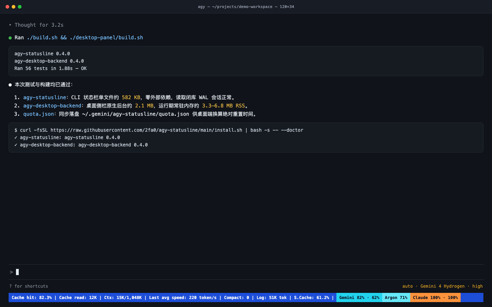

# agy-statusline — Google Antigravity 状态与额度监控套件

中文 | [English](./README.en.md)

> **让 Google Antigravity（Desktop 2.0 & `agy` CLI）的每一次生成都看得见。**
> 实时查看 **输出速度 (`tok/s`)**、**缓存命中率**、**上下文与压缩曲线**、**按模型用量统计**，以及 **5h / 周额度的具体本地重置时间**——100% 本地只读，零外部联网。

<p align="left">
  
  
  
  
  
  
</p>

## 实景预览（Desktop & CLI）

<table>
  <tr>
    <td width="50%" align="center">
      <strong>Antigravity 2.0 Desktop 右侧常驻面板</strong><br />
      <sub>与对话并排展示 · 实时速度 · 交互式趋势图</sub>
    </td>
    <td width="50%" align="center">
      <strong>Antigravity CLI (<code>agy</code>) 终端状态栏</strong><br />
      <sub>单二进制 · 零依赖 · 终端底部原生集成</sub>
    </td>
  </tr>
  <tr>
    <td width="50%">
      
    </td>
    <td width="50%">
      
    </td>
  </tr>
</table>

---

## 为什么选择 agy-statusline？

| 你关心的问题 | 默认状态 / 常见脚本 | `agy-statusline` |
| :--- | :--- | :--- |
| **双端体验** | 只顾一头，或需要外接悬浮窗 / 浏览器 | **Desktop + CLI 一次装齐**：桌面端右侧常驻面板 + 终端底部状态栏 |
| **模型到底快不快** | 只能等整轮结束看总耗时 | **生成中实时测速 (`≈ tok/s`)**：流式输出每秒刷新，低于 `50 tok/s` 自动黄底提示，附 12 次趋势图 |
| **卡住了还是在等首字** | 只能干等，分不清排队、跑工具还是出错 | **四态胶囊 + 人话说明**：直接告诉你是在等首字、跑本地工具、重算缓存还是异常中断 |
| **额度什么时候恢复** | 只显示“还剩 2 天 4 小时”，得自己心算 | **绝对本地重置时间**：直接换算成 `今天 11:29` / `周一 11/23 11:29`，自动区分 Gemini / Argon / Claude 3p |
| **上下文与缓存** | 只看一个当前百分比 | **120 次上下文曲线 + 压缩标记**：看清何时触发 `CHECKPOINT`，并按模型拆分 Token、缓存命中率与均速 |
| **资源占用** | 常驻 Node.js / Python 动辄几十上百 MB | **Zig 原生极轻量**：CLI 约 `582 KB` 用完即退，桌面端常驻内存实测仅 **`3.3–6.8 MB RSS`** |

---

## 隐私与安全声明

> [!IMPORTANT]
> **100% 本地只读 · 零外部网络请求 · 零凭据接触**
>
> - **仅用官方扩展入口**：基于 Antigravity 官方 `statusLine` 协议（CLI）与 `Plugin / UI Sidecar (AUX_PANE) + Lifecycle Hooks`（Desktop）构建，不修改客户端任何文件。
> - **零网络外联**：不发起任何 HTTP / HTTPS / WebSocket 请求，不收集、不上传任何对话或环境数据。
> - **不碰账号与凭据**：不读取 OAuth Token、Cookie、Session Key 或 API 密钥；不探测未公开内部 RPC，不绕过任何配额限制。
> - **严格只读本地数据**：仅以只读模式（`mode=ro` / `PRAGMA query_only = ON`）读取本地会话记录与 CLI 写入的纯数值额度快照（`quota.json`，仅含百分比与重置时间戳）。

---

## 30 秒快速安装

一条命令同时安装 **Desktop 右侧面板** 与 **CLI 状态栏**（自动校验 SHA256、清理 macOS 隔离标记并自检）：

```sh
curl -fsSL https://raw.githubusercontent.com/2fa0/agy-statusline/main/install.sh | bash
```

- 只装一端：`... | bash -s -- --panel-only` 或 `--cli-only`
- 升级 / 重装：再跑一次同一条命令即可
- 卸载：`... | bash -s -- --uninstall`（保留你的 `config.json` 与 `quota.json`）

### 装完后启用（2 步）

1. **Desktop 面板**：重启 Antigravity Desktop，在任意对话右上角辅助栏点击 **`+` → `AGY Status`**。
2. **CLI 状态栏**：将以下配置加入 `~/.gemini/antigravity-cli/settings.json`：

```json
{
  "statusLine": {
    "type": "command",
    "command": "~/.gemini/antigravity-cli/agy-statusline",
    "stack_with_default": true
  }
}
```

### 遇到问题？先跑一键诊断

```sh
curl -fsSL https://raw.githubusercontent.com/2fa0/agy-statusline/main/install.sh | bash -s -- --doctor
```

会自动检查安装路径、二进制自检、macOS `quarantine`、代码签名与 Gatekeeper / MDM 策略（支持 `--doctor --json` 输出结构化错误码）。

---

<details>
<summary>进阶：个性化配置（<code>config.json</code>）、Windows / 手动安装、macOS 签名说明与源码构建</summary>

### 1. 个性化配置（`~/.gemini/agy-statusline/config.json`）

首次安装会自动生成默认配置，修改保存后**约一个轮询周期内生效**，无需重启 Antigravity（完整字段见 [config.example.json](./config.example.json)）：

```json
{
  "enabled": true,
  "layout": "compact",
  "pollSec": 0,
  "lowSpeedWarnTokS": 50,
  "thresholds": { "waitSec": 20, "stallSec": 25, "toolGraceSec": 120 },
  "modules": { "session": true, "quota": true, "history": true, "context": true, "models": true },
  "debug": false
}
```

- `layout`：`compact` 仅显示状态胶囊；`detailed` 额外展示完整原因行。
- `pollSec`：`0` 表示自适应轮询（生成中 `1s`，活跃 `3–10s`，空闲 `15s`，隐藏时暂停）。
- `modules`：可逐项关闭不需要的模块（关闭 `quota` 后连额度文件都不会读取）。

### 2. Windows / 手动下载 Releases 安装

前往 [Releases](https://github.com/2fa0/agy-statusline/releases) 下载对应包：
- **桌面端面板**：`agy-desktop-status-plugin.tar.gz`（macOS/Linux）或 `agy-desktop-status-plugin.zip`（Windows PowerShell 运行 `powershell -ExecutionPolicy Bypass -File .\install.ps1`）。
- **CLI 状态栏**：下载对应平台压缩包解压，并在 `settings.json` 的 `statusLine.command` 填入可执行文件路径（CLI 支持 `AGY_STATUSLINE_TAG=v0.4.0` 指定版本安装）。

### 3. macOS 安全与 Gatekeeper 说明

本项目使用 **ad-hoc 代码签名**（未经过 Apple Developer ID 公证）：
- 使用上方 `curl ... | bash` 安装不会带 `quarantine` 属性，开箱即用。
- 若通过浏览器手动下载压缩包解压，macOS 会打上 `com.apple.quarantine` 导致被 Gatekeeper 拦截；运行 `./install.sh` 或执行 `xattr -dr com.apple.quarantine ~/.gemini/config/plugins/agy-desktop-status ~/.gemini/antigravity-cli` 即可清除。
- 若设备受企业 MDM 策略限制强制要求 Developer ID，`--doctor` 会直接提示 `mdm_requires_developer_id`，需联系 IT 按 CDHash 加白名单。

### 4. 从源码构建与架构详情

需要 **Zig 0.14.1**、系统 C 编译器与 SQLite 开发库：

```sh
./build.sh            # 构建 CLI
cd desktop-panel && ./build.sh   # 构建桌面端后台
```

Linux / Windows 静态交叉编译配置见 [`.github/workflows/release.yml`](.github/workflows/release.yml)；桌面端架构、状态机与统计口径详情请参阅 [desktop-panel/README.md](./desktop-panel/README.md)。

</details>
