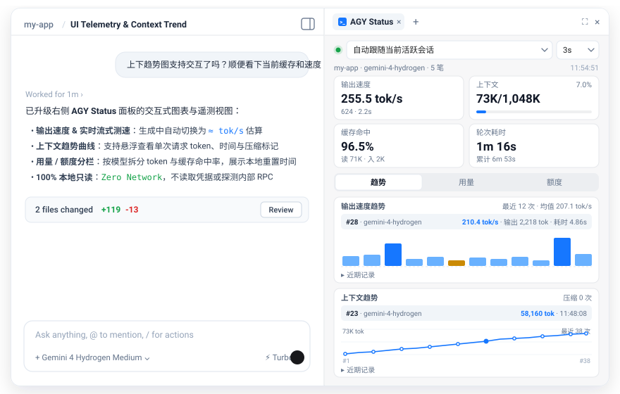

# AGY Desktop Status — Antigravity 2.0 右侧辅助栏常驻状态面板插件

专为 **Antigravity 2.0 桌面端** 打造的只读性能与上下文遥测面板（不与 CLI 版 Zig 代码耦合）。基于官方 **Plugin + UI Sidecar (`SIDECAR_UI_ENTRYPOINT_AUX_PANE`) + Lifecycle Hooks** 架构（Node sidecar + 常驻 Python 采集 worker，无独立 MCP 服务），在对话窗口右侧辅助栏里作为常驻 Tab 与会话同屏展示：

- **实时输出速度（生成中）**：模型回话时卡片自动切成实时模式：`≈ 110.7 tok/s`、`已输出 339 字 · 128 字/s · 2.6s`，并在页头挂上 `生成中 · Ns` 胶囊。数据来自 AGY 正在写入的未完成 step 行（`status = GENERATING`，`steps.step_payload` 随流式文本增长），按同一会话已完成步骤的「字数 / 输出 token」比例换算；生成中 1s 一轮轮询，结束后回到精确的平均速度与历史趋势。
- **平均输出速度 (`Last avg speed`)**：最近一次模型生成的输出速度（`tok/s`），低于 `50 tok/s` 自动黄色高亮提示，附带最近 12 次生成的**可交互速度柱状趋势图**（鼠标悬浮柱子或下方列表行即可联动高亮并查看单次输出 token 数、耗时与模型明细）。
- **额度重置时间（`周额度` / `5h 额度`）**：同时给出剩余百分比与**具体本地重置时间**（如 `重置于 11/23 周一 11:29 · 剩 3 天 1 小时`），不用再自己把 “还剩 2 天 4 小时” 换算成时间点。数据来自 CLI 状态栏写下的本地快照 `~/.gemini/agy-statusline/quota.json`（可用 `AGY_STATUSLINE_QUOTA_FILE` 覆盖）；快照过期时按 5h / 7 天周期推算并标注。
- **轮次 / 会话耗时**：基于本地 `transcript.jsonl` 时间戳计算当前轮次耗时与整个会话总耗时。
- **上下文占用 (`Ctx`)** & **Cache 命中率 (`Cache hit`)**：只读解析本地会话库中的输入、缓存读取与缓存写入字段（若本地未落盘对应字段则显示 `--`，不伪造数据）。




### 会话用量、上下文趋势与模型统计

桌面面板新增三组统计，均只读取本地记录，不调用内部 RPC：

- **上下文趋势与压缩事件**：显示最近最多 120 次已完成请求的输入上下文曲线，虚线标出 `status=DONE` 的 `CHECKPOINT`。压缩次数覆盖整份日志；上下文变小不自动算作压缩，也不预设 256k 等压缩阈值。可展开近期记录查看本地时间与数值。
- **最近回复请求 / 会话累计**：并列展示 token 用量和缓存命中率。累计包含已完成的 `PLANNER_RESPONSE` 与 `CHECKPOINT`；token 按日志的 `input_tokens + cache_read_tokens + output_tokens` 相加，不包含未记录的缓存写入。重复发送的输入会按每次请求累计，并非去重后的上下文大小。
- **按模型统计**：分别展示 token、缓存命中率和平均输出速度；合并同模型的思考档位后缀，缺失模型归入“未知模型”，不使用当前模型回填历史。速度来自本地数据库中能匹配模型的有效样本，按输出总量 / 耗时总量计算，并注明样本数。

只有输入、缓存读取、输出三个字段均有效的请求才进入累计，界面显示“已记录 / 总请求数”覆盖情况。会话缓存命中率为有效请求的缓存读取总量 /（未缓存输入总量 + 缓存读取总量），不是各次百分比的平均。日志缺失时显示未知；缺少速度数据不从日志时间差猜测。

CLI 在终端宽度足够时显示 `Compact: N`，空间不足时省略；宽度足够时再显示 `Log: … tok` 与 `S.Cache: …%`，分别代表相同日志口径的会话累计 token 和加权缓存命中率。用量不完整时附带覆盖数量（例如 `2/3`）。 会话累计值与读取位置缓存在 `~/.gemini/agy-statusline/sessions/`，后续只读取追加的完整日志行；缓存不保存会话正文，缺失或失效时自动重建。

插件通过宿主扩展入口加载；本地日志和 SQLite/protobuf 数据格式本身不属于我们能保证稳定的公开接口，宿主升级可能导致字段不可用。

## 合规与安全保障

- **扩展入口**：使用 Antigravity 插件机制（`plugin.json`、`sidecars/status/sidecar.json`、`hooks.json`）。
- **只读与零网络（Local Read-Only · Zero Network）**：SQLite 连接强制使用 `mode=ro` 与 `PRAGMA query_only = ON`；无任何外部网络请求、不读取 OAuth Token 或凭据、不探测未公开的内部 RPC 接口、不绕过任何配额或权限限制。
- **额度来源透明**：桌面端本身不向插件暴露额度，面板只读取 CLI 状态栏自己写下的 `quota.json`（仅百分比与重置时间戳，无凭据）；文件不存在时就显示「未采集」。
- **开箱即用**：运行时仅依赖 Antigravity 内置 Node (`sidecar_sdk`) 与已安装的 `python3`（零第三方 Python 运行时依赖），前端单文件 HTML 已预构建在 `dist/index.html` 中，普通用户无需安装 Node.js 或执行 `npm build`。

---

## 傻瓜式安装与使用

### 方式 A：一行命令自动安装（macOS / Linux）

```sh
curl -fsSL https://raw.githubusercontent.com/2fa0/agy-statusline/main/desktop-panel/install.sh | bash
```

### 方式 B：从 Release 压缩包或本地目录安装

- **macOS / Linux**：
  ```sh
  chmod +x ./install.sh
  ./install.sh          # 本地源码目录默认软链接安装；也可传 --copy 独立复制文件
  ```
- **Windows (PowerShell)**：
  ```powershell
  powershell -ExecutionPolicy Bypass -File .\install.ps1
  ```

### 打开右侧常驻面板

1. 安装或更新插件后，**打开或重启 Antigravity Desktop**；
2. 在任意对话窗口右上角辅助栏点击 **`+` 菜单** → 选择 **`AGY Status`**（官方 `SIDECAR_UI_ENTRYPOINT_AUX_PANE` 入口，与对话画布同屏并排，不打断当前会话）；
3. 顶部下拉框默认**自动跟随当前活跃会话**，也可随时下拉切换查看历史会话。

> 右侧辅助栏是官方 API 中唯一能与对话画布同屏并排的位置。Antigravity 2.x 的 sidecar UI 只有 `AUX_PANE` / `FULL_PANE` / `SIDEBAR` 三种入口，**没有顶栏（title bar）挂载点**，所以状态条无法真正贴到窗口上边栏。

### 性能设计

面板默认活跃时每 3 秒刷新一次，空闲时降频；遥测侧通过以下方式减少开销：

- **常驻 worker**：`telemetry.py --serve` 只启动一次，之后走 JSON-lines 请求，避免每次轮询重复启动 Python；具体耗时取决于日志大小、数据库变化与缓存命中情况；worker 崩溃时自动回退到一次性子进程，不会白屏。
- **指纹缓存**：`db` / `-wal` / `transcript` / `active_session.json` 的文件身份、mtime 和 size 全未变化时复用遥测快照；会话列表独立更新，读取失败的结果不缓存。
- **transcript 增量解析**：按字节 offset 只读新增行，避免每次重新解析完整日志；首次读取仍需处理已有内容。
- **自适应刷新**：活跃时按所选的 3/5/10s 间隔刷新，空闲 45s 后自动降到 15s，面板隐藏时暂停轮询，后台进程与缓存仍保留。

### 卸载

- **macOS / Linux**：
  ```sh
  ./install.sh --uninstall
  ```
- **Windows (PowerShell)**：
  ```powershell
  powershell -ExecutionPolicy Bypass -File .\install.ps1 -Uninstall
  ```

---

## 开发者指南：从源码重新构建前端 UI & 运行测试

如果你修改了 `ui/src/app.ts` 或 `ui/src/template.html`，可以在本地（需 Node.js >= 20）重新打包单文件 `dist/index.html`：

```sh
cd ui
npm install
npm run build
```

运行后端与协议单元测试：

```sh
python3 -m unittest discover -s tests
```

安装 UI 开发依赖后，运行 worker 恢复和刷新间隔的回归测试：

```sh
node --test tests/test_sidecar.mjs
```
